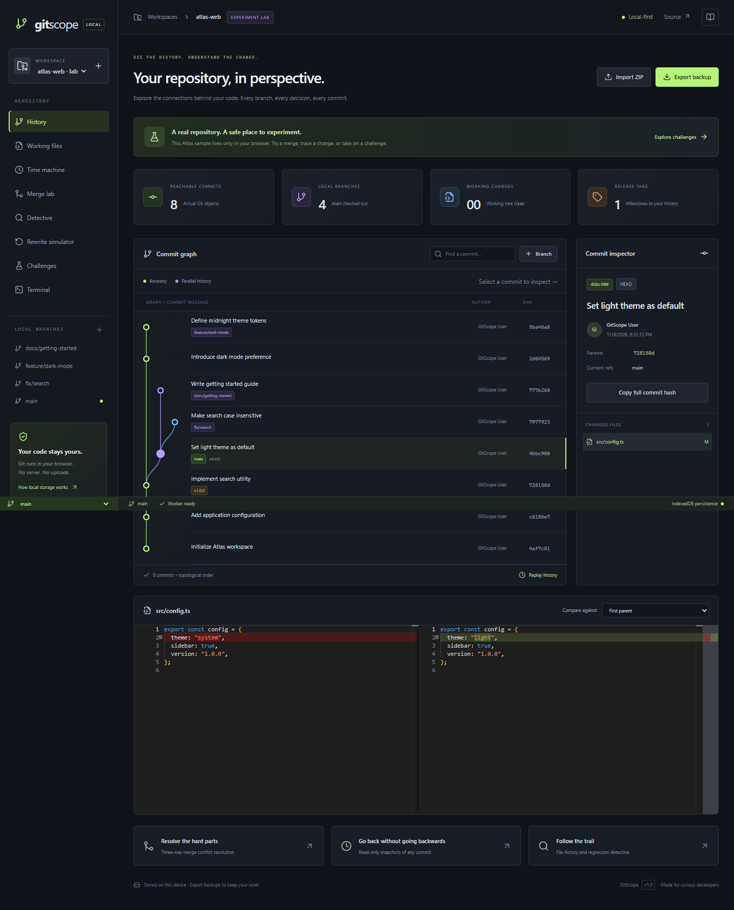

# GitScope

**See the history. Understand the change.**

A local-first visual Git workspace with real Git objects, an interactive commit graph, three-way conflict resolution and an offline experiment lab.

[Open GitScope](https://aadi90392.github.io/gitscope/) · [Checks](https://github.com/aadi90392/gitscope/actions)



## Try it in two minutes

1. Open the app. The **Atlas experiment lab** creates a real, isolated repository in your browser.
2. Select a commit in **History** to inspect parents, changed files and a Monaco diff.
3. Open **Merge lab**, select `feature/dark-mode`, and choose **Compare & merge**.
4. Compare Base, Current and Incoming. Choose **Use incoming** or edit the result, then **Mark resolved** and **Complete merge**.
5. Return to History: the new commit has two parents. Export a backup to keep the repository.

## What works

| Tool              | Behavior                                                                                                      |
| ----------------- | ------------------------------------------------------------------------------------------------------------- |
| History           | Topologically ordered commit DAG, branches, tags, HEAD and parent-to-commit diffs                             |
| Working files     | Create, edit, delete, stage and commit text files; clean-worktree checkout guard                              |
| Time machine      | Read-only snapshots and step-through replay of reachable commits                                              |
| Merge lab         | Common-base three-way text merge, manual resolution, deletion resolution, abort and two-parent commits        |
| Detective         | File history, line attribution along first-parent history and guided manual regression bisection              |
| Terminal          | Controlled `git status`, `log`, `add`, `commit`, `branch`, `checkout`, `merge`, `cherry-pick`, `tag` commands |
| Rewrite simulator | Visual pick, squash, drop and reorder planning; explicitly simulated, never rewrites repository history       |
| Challenges        | Validate branch creation, a resolved dark-mode merge and the search fix against repository state              |
| Workspaces        | Independent repositories, ZIP imports with `.git`, portable backups and IndexedDB persistence                 |
| Offline           | Service worker caches the application after the first successful online load                                  |

## Architecture

```text
React + TypeScript + Zustand
  ├── D3 commit graph
  ├── Monaco file editor / diff viewer
  └── typed request / response messages
          ↓
      Web Worker (serialized operations + browser lock)
          ├── isomorphic-git: objects, refs, index, commits
          ├── node-diff3: three-way text merging
          ├── diff: line changes and attribution
          └── LightningFS → IndexedDB
```

Git work runs outside the UI thread. The worker flushes LightningFS before acknowledging operations, so an immediate reload retains completed writes. A browser lock serializes repository operations across tabs. Conflicts are staged in workspace metadata; comparison does not change working files. Completing a merge writes its resolved tree and a commit with both parents.

The graph orders commits by ancestry rather than trusting timestamps. Backups include the actual `.git` objects and working files in a versioned ZIP envelope. Import creates a separate workspace and validates archive paths and reachable trees.

## Local development

Requires Node.js 24 and npm.

```sh
npm ci
npm run dev
# http://127.0.0.1:5175/gitscope/

npm test
npm run build
npx playwright install chromium
npm run test:e2e
```

On Windows, the browser suite uses installed Chrome. CI uses Playwright Chromium. `playwright.config.ts` contains this selection.

## Importing your repository

ZIP a small repository **including its hidden `.git` folder**, then use **Import ZIP**. A normal GitHub “Download ZIP” contains source files only and cannot provide history. GitScope edits the imported browser copy; it never changes the original folder on your computer. Export before clearing site data or changing devices.

Limits: 500 reachable commits, 5,000 archive entries/files, 25 MiB uncompressed backups and 1 MiB per editable text file. Symlinks and submodules are rejected. Binary contents are retained in backups, but text editing, diffing and merging reject binary files. Merge workflows are aimed at small text repositories; this is not a replacement for every native Git operation.

## Deliberate boundaries

- No account, backend, analytics or mandatory paid API. Repository contents stay in browser storage unless you export them. Hosting still receives ordinary page/asset requests.
- Browser storage can be cleared or evicted. **Keep exported backups.** Offline use requires the app to have loaded and cached online first.
- No remote clone/push, shell execution, Git hooks or arbitrary test execution.
- Rewrite tools are a **simulator**, not a native rebase implementation. They do not replay patches.
- Time machine shows commit trees and **current** refs; Git commits do not preserve historical branch-pointer positions.
- Line attribution follows the first-parent path and is not a complete native `git blame` implementation. Bisection relies on your good/bad assessments.
- Multiple merge bases and advanced rename-aware merges are not supported. Conflict-marker validation does not prove that the resulting program is correct.
- New local commits use `GitScope User <local@gitscope.invalid>`; this lab does not impersonate your GitHub identity.

## Verification

Engine tests cover real object history, merge parents, conflict guards, cherry-pick, fast-forward, abort, staging, deletions, backup isolation, path validation and graph ordering. The browser test exercises the actual worker and Monaco editor, completes a conflict merge, reloads immediately, validates a challenge, downloads a backup, reloads offline and checks mobile overflow.

Every push to `main` runs unit tests, a production build and the browser workflow before GitHub Pages deployment. GitHub Pages serves static assets; IndexedDB is local storage, not a hosted database. This architecture requires no recurring backend infrastructure; hosting is subject to GitHub’s current plan and limits.

## Stack

React 19 · TypeScript · Vite · Tailwind CSS · Zustand · D3 · Monaco · isomorphic-git · LightningFS · node-diff3 · Vitest · Playwright · GitHub Pages

MIT © 2026 Aditya Upadhyay
